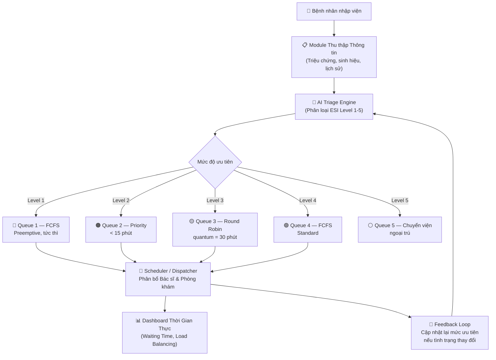

# 🏥 Đề Tài 2 — Ứng Dụng Thuật Toán Multilevel Queue & Priority Scheduling trong Hệ Thống Phân Loại Bệnh Nhân Cấp Cứu (Triage)

> **GVHD:** ThS. Lê Văn Phong | **Năm học:** 2026 – 2027

---

## 1. 🎯 Tổng Quan & Vấn Đề Thực Tiễn

Trong các khoa cấp cứu, việc phân loại bệnh nhân (Triage) thủ công dễ dẫn đến:
- ⚠️ Bệnh nhân nguy kịch phải chờ quá lâu → tăng tử vong
- ⚠️ Nguồn lực y tế (bác sĩ, phòng khám) phân bổ không tối ưu
- ⚠️ Hàng chờ bùng nổ trong giờ cao điểm

**Giải pháp:** Áp dụng thuật toán **Multilevel Queue + Priority Scheduling** (vay mượn từ lý thuyết Hệ Điều Hành) để xây dựng một module phần mềm tự động phân loại và xếp hàng bệnh nhân theo mức độ ưu tiên y tế.

---

## 2. 🧠 Ý Tưởng Cốt Lõi

### 2.1 Ánh Xạ Bài Toán Triage → Lập Lịch CPU

| Khái niệm OS | Ánh xạ Y tế |
|---|---|
| Process (tiến trình) | Bệnh nhân |
| Priority Level | Mức độ nguy kịch (ESI Level 1–5) |
| CPU Burst Time | Thời gian điều trị ước tính |
| Ready Queue | Hàng chờ khoa cấp cứu |
| I/O Wait | Chờ xét nghiệm / chẩn đoán hình ảnh |
| Preemption | Bệnh nhân nguy kịch chen vào ngay |

### 2.2 Thang Phân Loại — Emergency Severity Index (ESI)

```
Level 1 (Đỏ)   — Nguy kịch tức thì    → Vào ngay, không chờ
Level 2 (Cam)   — Rất cấp              → Chờ < 15 phút
Level 3 (Vàng)  — Cấp, không nguy hiểm → Chờ < 60 phút
Level 4 (Xanh)  — Ít cấp              → Chờ < 2 giờ
Level 5 (Trắng) — Không cấp           → Chuyển khoa ngoại trú
```

---

## 3. 🏗️ Kiến Trúc Hệ Thống



---

## 4. ⚙️ Chi Tiết Thuật Toán

### 4.1 Multilevel Queue Scheduling

Hệ thống duy trì **5 hàng đợi riêng biệt**, mỗi queue có thuật toán lập lịch riêng:

```
┌─────────────────────────────────────────────────────────┐
│  QUEUE 1 (ESI-1): Preemptive Priority                   │  ← Độ ưu tiên CAO NHẤT
│  QUEUE 2 (ESI-2): Priority Scheduling                   │
│  QUEUE 3 (ESI-3): Round Robin (quantum=30min)           │
│  QUEUE 4 (ESI-4): First Come First Served               │
│  QUEUE 5 (ESI-5): Chuyển ngoại trú                     │  ← Độ ưu tiên THẤP NHẤT
└─────────────────────────────────────────────────────────┘
```

**Quy tắc:**
- Queue có số nhỏ hơn luôn được phục vụ trước
- Bệnh nhân Queue 1 có thể **preempt** (chen ngay) bất kỳ bệnh nhân nào đang được phục vụ ở queue thấp hơn
- Aging mechanism: Bệnh nhân chờ quá lâu ở queue thấp sẽ được **nâng level** tự động

### 4.2 Priority Score Formula

```
Priority_Score = w1 × ESI_Level 
               + w2 × Waiting_Time 
               + w3 × Vital_Signs_Score 
               + w4 × Age_Factor
               + w5 × Comorbidity_Score

Trong đó:
  ESI_Level        = 1 (nguy kịch) → 5 (nhẹ)
  Waiting_Time     = thời gian đã chờ (phút)
  Vital_Signs_Score= điểm số từ nhịp tim, huyết áp, SpO2...
  Age_Factor       = ưu tiên trẻ em & người cao tuổi
  Comorbidity_Score= điểm bệnh nền (tiểu đường, tim mạch...)
```

### 4.3 Dynamic Re-Prioritization (Aging)

```python
def aging_update(patient, current_time):
    """Cập nhật lại mức ưu tiên định kỳ mỗi 5 phút"""
    wait_minutes = (current_time - patient.arrival_time).minutes
    
    # Bệnh nhân Level 3 chờ > 45 phút → tăng lên Level 2
    if patient.esi_level == 3 and wait_minutes > 45:
        patient.esi_level = 2
        reassign_queue(patient)
    
    # Bệnh nhân Level 4 chờ > 90 phút → tăng lên Level 3
    elif patient.esi_level == 4 and wait_minutes > 90:
        patient.esi_level = 3
        reassign_queue(patient)
```

---

## 5. 🔬 Tính Năng Mô-đun Phần Mềm

### 5.1 Module Nhập Liệu (Input)
- ✅ Y tá nhập triệu chứng ban đầu qua form
- ✅ Tích hợp thiết bị đo sinh hiệu tự động (nhịp tim, SpO2, huyết áp)
- ✅ Tra cứu lịch sử bệnh án (HIS/EMR integration)

### 5.2 Module AI Triage Engine
- ✅ Mô hình phân loại (Decision Tree / Rule-based / ML)
- ✅ Gợi ý ESI Level và giải thích lý do
- ✅ Override thủ công bởi y tá/bác sĩ

### 5.3 Module Scheduler
- ✅ Multilevel Queue với 5 hàng đợi
- ✅ Load balancing: phân bổ bệnh nhân đều giữa các bác sĩ
- ✅ Dynamic aging: cập nhật mức ưu tiên định kỳ

### 5.4 Dashboard Thời Gian Thực
- ✅ Hiển thị hàng chờ theo từng mức độ
- ✅ Thống kê: Average Waiting Time, Throughput
- ✅ Cảnh báo khi hàng chờ Level 1–2 tắc nghẽn
- ✅ Lịch sử phân loại và audit log

---

## 6. 🛠️ Công Nghệ Đề Xuất

| Thành phần | Công nghệ gợi ý |
|---|---|
| **Backend** | Python (FastAPI) hoặc Node.js |
| **Scheduler Core** | Python với `heapq`, `queue.PriorityQueue` |
| **AI/ML** | scikit-learn (Decision Tree, Random Forest) |
| **Database** | PostgreSQL (bệnh án) + Redis (real-time queue) |
| **Frontend** | React.js / Next.js + Chart.js |
| **Real-time** | WebSocket (Socket.io) |
| **Deployment** | Docker + Nginx |

---

## 7. 📊 Thực Nghiệm & Đánh Giá

### Tiêu Chí Đánh Giá
- **Average Waiting Time** theo từng ESI Level
- **Starvation Rate**: Tỷ lệ bệnh nhân chờ quá giới hạn cho phép
- **Throughput**: Số bệnh nhân được xử lý / giờ
- **Priority Inversion Rate**: Trường hợp bệnh nhân quan trọng bị "kẹt sau"

### Phương Pháp Thực Nghiệm
1. **Simulation**: Mô phỏng bằng dữ liệu synthetic (1000+ ca)
2. **Benchmark**: So sánh với các thuật toán khác (FCFS thuần, Round Robin đơn giản)
3. **Dataset**: Dùng dataset MIMIC-IV Emergency Department (public) hoặc dữ liệu ẩn danh hóa từ bệnh viện

---

## 8. 🗓️ Kế Hoạch Thực Hiện (Gợi Ý)


---

## 9. 💡 Điểm Nhấn & Đóng Góp Khoa Học

> **Đây không chỉ là một ứng dụng web đơn thuần — đây là nghiên cứu liên ngành giữa Khoa học máy tính và Y học khẩn cấp.**

**Điểm mới:**
1. 🔑 Áp dụng lý thuyết lập lịch đa mức (Multilevel Queue) vào bài toán Triage — hiếm thấy trong tài liệu Việt Nam
2. 🔑 Cơ chế **Dynamic Aging** phòng tránh Starvation cho bệnh nhân cấp thấp
3. 🔑 Tích hợp **AI phân loại** kết hợp với **rule-based scheduler** → giải thích được (Explainable AI)
4. 🔑 Load balancing thông minh giữa các bác sĩ dựa trên workload thực tế

---

## 10. 📚 Tài Liệu Tham Khảo Gợi Ý

- Silberschatz, A. et al. — *Operating System Concepts* (Dinosaur Book) — Chương Scheduling
- Gilboy, N. et al. — *Emergency Severity Index (ESI): A Triage Tool* — AHRQ
- MIMIC-IV ED Dataset — PhysioNet (https://physionet.org)
- Các paper trên IEEE/ACM về "Patient Scheduling", "Triage Optimization", "Hospital Queue Management"

---

*📌 Tài liệu này được tạo như một bản phác thảo ý tưởng ban đầu. Mọi thành phần có thể điều chỉnh theo yêu cầu của GVHD ThS. Lê Văn Phong.*
