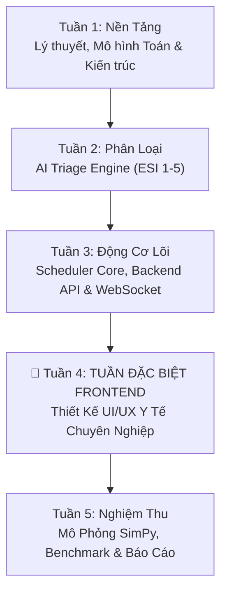

# 🗺️ LỘ TRÌNH 5 TUẦN THỰC HIỆN ĐỀ TÀI (MQPSS ROADMAP)

> **Đề tài:** Ứng Dụng Thuật Toán Multilevel Queue & Priority Scheduling trong Hệ Thống Phân Loại Bệnh Nhân Cấp Cứu (Triage)  
> **GVHD:** ThS. Lê Văn Phong | **Năm học:** 2026 – 2027

---

## 📅 Bảng Tổng Quan Lộ Trình 5 Tuần

| Tuần | Tên Chuyên Đề | Trọng Tâm Thực Hiện | Chi Tiết |
| :---: | :--- | :--- | :---: |
| **01** | **Khởi Động & Kiến Trúc** | Chuẩn hóa ESI v4, công thức Priority Score ($w_1 \dots w_5$), đặc tả cơ chế Preemption & Aging, thiết kế Database Schema (Postgres + Redis) và dựng khung Docker. | [Xem chi tiết](file:///d:/lehongphong/Roadmap/tuan_01.md) |
| **02** | **AI Triage Engine** | Xây dựng bộ phân loại lâm sàng 2 lớp: Rule-based chốt chặn ca nguy kịch (Safety-first) kết hợp Machine Learning có khả năng giải thích (Explainable AI), kèm API tiếp nhận và cơ chế Y tá Override. | [Xem chi tiết](file:///d:/lehongphong/Roadmap/tuan_02.md) |
| **03** | **Scheduler Core & Backend** | Cài đặt cấu trúc 5 hàng đợi độc lập (`heapq`, `deque`), Dynamic Aging Worker chống Starvation, thuật toán Dispatcher cân bằng tải bác sĩ, và hoàn thiện bộ REST API + WebSocket Server. | [Xem chi tiết](file:///d:/lehongphong/Roadmap/tuan_03.md) |
| **04** | 🌟 **TUẦN ĐẶC BIỆT: FRONTEND** | **Dành riêng 1 tuần chuyên sâu thiết kế UI/UX y tế:** Clinical Design System (bảng màu ESI quốc tế), Trạm tiếp đón Triage siêu tốc (phím tắt bàn phím), Bảng 5 hàng đợi Real-time động (Kanban có animation nhảy cột khi aging), Trạm bác sĩ cấp cứu, và Bảng cảnh báo ùn ứ khoa. | [Xem chi tiết](file:///d:/lehongphong/Roadmap/tuan_04.md) |
| **05** | **Mô Phỏng & Báo Cáo** | Xây dựng mô phỏng sự kiện rời rạc với `SimPy` (1.000+ ca bệnh theo phân phối Poisson), chạy Benchmark đối đầu 3 thuật toán (*FCFS vs Pure Priority vs MQPSS*), xuất đồ thị khoa học, đóng gói Docker Compose và hoàn thiện báo cáo gửi GVHD ThS. Lê Văn Phong. | [Xem chi tiết](file:///d:/lehongphong/Roadmap/tuan_05.md) |

---

## 📌 Các Điểm Nhấn Độc Đáo Của Đề Tài
1. **Tính liên ngành cao:** Ánh xạ hoàn hảo giữa lý thuyết lập lịch CPU (Hệ điều hành) vào nghiệp vụ phân loại cấp cứu (Y học khẩn cấp).
2. **Cơ chế chống đói tài nguyên (Dynamic Aging):** Đảm bảo không có bệnh nhân ca nhẹ nào bị bỏ quên vô thời hạn.
3. **Tuần 4 chuyên sâu Frontend y tế:** Không làm giao diện sơ sài; đầu tư toàn diện vào Ergonomics phòng cấp cứu, phím tắt nhanh, khả năng tiếp cận WCAG 2.1 AA và báo động âm thanh/thị giác chuẩn lâm sàng.
4. **Chứng minh bằng số liệu thực nghiệm:** Dùng mô hình toán học và mô phỏng DES (SimPy) với số liệu đối chứng khoa học chặt chẽ.
